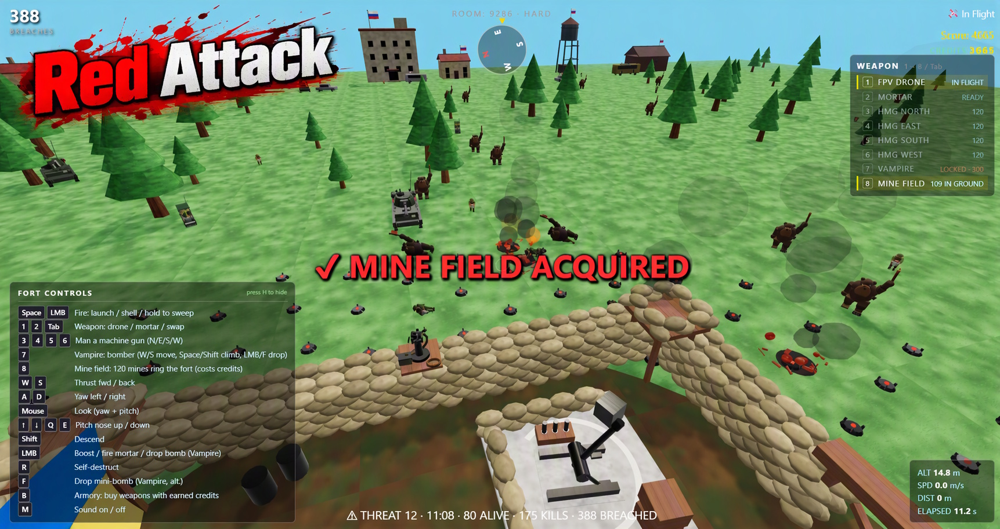

# 🔴 Red Attack

A browser-based multiplayer fort defense game. A handful of pilots man the weapon stations of an open fortified position and hold it against an escalating horde for 20 minutes. Three weapons come free with the fort: fly a kamikaze drone in first-person view for precision work, stand at the tube mortar and put shells across the middle of the field, or run one of the four heavy machine guns on the berm. A fourth — the Vampire mini-bomber — sits in the armory until a pilot buys it out of the credits his own kills pay out (see [Credits and the Armory](#credits-and-the-armory)). The armory also sells something that is not a station at all: a hundred and twenty mines in the dirt around the wire, bought on key `8` for 500 credits ([The Mine Field](#the-mine-field)). The horde advances out of a Russian-held village on the north and east edges of the map, so the houses, barns, flats and parked cars that fly the tricolor are both the cover the enemies pour out of and targets in their own right.



## Tech Stack

| Layer | Technology |
|-------|-----------|
| Rendering | Three.js (WebGL) |
| Networking | Colyseus 0.18 (WebSocket) |
| Language | TypeScript |
| Build | Vite (client), tsx (server) |
| Monorepo | npm workspaces |

## Project Structure

```
red-attack/
├── packages/
│   ├── client/          # Vite + Three.js frontend
│   │   └── src/
│   │       ├── audio/       # AudioManager (Web Audio SFX) + BattleCries (ru-RU speech)
│   │       ├── input/       # InputManager (keyboard + mouse)
│   │       ├── network/     # Colyseus client wrapper
│   │       ├── scene/       # Three.js scene, drone, enemies, terrain
│   │       │                #   Outpost.ts / VillageModels.ts — the fort and the
│   │       │                #   destructible village (models, flags, ruins)
│   │       │                #   Mortar.ts / MortarFx.ts — the tube, its aim
│   │       │                #   rings and the shell / shell-camera layer
│   │       │                #   Structures.ts — client side of the village state
│   │       │                #   VehicleModels.ts — horde vehicles
│   │       │                #   Bomb.ts — the Vampire's mini-bombs in the air
│   │       │                #   Mines.ts — the mine field in the dirt around the fort
│   │       ├── ui/          # HUD overlay + the armory panel
│   │       └── main.ts      # Game loop
│   ├── server/          # Colyseus game server
│   │   └── src/
│   │       ├── rooms/       # GameRoom (state, physics, horde, village, shells, armory)
│   │       └── index.ts     # HTTP + WebSocket entry
│   └── shared/          # Shared types & game constants
│       └── src/
│           ├── types.ts
│           ├── constants.ts
│           ├── mortar.ts      # weapon types, range clamp, shared ballistics
│           ├── vampire.ts     # bomber stats: bomb stack, altitude band, re-arm
│           ├── mines.ts       # the mine field: six rings, trigger radius, blast
│           ├── hmg.ts         # the four guns, their belts and their arc of fire
│           ├── economy.ts     # SHOP_CATALOG, credit payouts, default loadout
│           ├── structures.ts  # STRUCTURE_SPECS, village layout, spawn edges
│           └── trees.ts       # deterministic tree scatter (renderer + collision)
├── docs/                # Design documents
└── package.json         # Workspace root
```

## Quick Start

Requires **Node 22+ / npm 9+**: `@colyseus/core` needs Node 22, and npm 7+ is needed
to link the workspace packages into `node_modules`. `scripts/check-engines.js` runs
on `preinstall` and refuses an older toolchain with an explanation (override with
`SKIP_ENGINES_CHECK=1`). Use `nvm use` to pick up the version in `.nvmrc`, or see
[Installing Node 22 on the Linux server](#installing-node-22-on-the-linux-server).

```bash
# Install dependencies
npm install

# Run dev (server + client concurrently)
npm run dev
```

Or run separately:

```bash
# Terminal 1 — Server (port 2567)
cd packages/server && npx tsx src/index.ts

# Terminal 2 — Client (port 5173)
cd packages/client && npx vite
```

Open **http://localhost:5173** in your browser.

## Controls

Seven stations, one key each: `1` mans the FPV drone pad, `2` mans the tube mortar,
`3`–`6` man the four heavy machine guns on the berm, and `7` mans the Vampire bomber —
which answers only once somebody has bought it at the armory
([Credits and the Armory](#credits-and-the-armory)). `Tab` walks the stations this
pilot actually holds, in the order drone → bomber → mortar → the four guns, so a
station he has not paid for is simply stepped over. `Space` then does whatever the
manned station does — launch the quad, send a shell at wherever the fort view is
pointing, run the belt of the gun you are standing at, or put the bomber off the pad.
With the tube manned, the left mouse button is a second trigger for the same shell; on
a machine gun it is the same held trigger as `Space`; on the bomber it releases a
mini-bomb, as does `F`. `B` raises the armory over the top of all of it. `8` is the one
key that buys instead of manning: it spends 500 credits on a mine field in the dirt around
the wire ([The Mine Field](#the-mine-field)).

### Keys

| Key | Action |
|-----|--------|
| **1 / 2** | Man the FPV drone pad / man the tube mortar |
| **3 / 4 / 5 / 6** | Man the north / east / south / west machine gun |
| **7** | Man the Vampire bomber — a dead key until it is bought, and the key that buys it while the armory is open |
| **8** | Buy a mine field for 500 credits — a hundred and twenty mines ring the fort; the armory's mine field row, too |
| **Tab** | Walk to the next station you hold (drone → bomber → mortar → the four guns → drone) |
| **B** | Open / close the armory — spend earned credits on weapons |
| **W / S** | Forward / backward thrust (in drone's facing direction) |
| **A / D** | Yaw rotation (additive with mouse); on a gun, traverse left / right |
| **Mouse X** | Yaw rotation (additive with A/D); on a gun, lay the barrel |
| **Mouse Y** | Pitch (tilt nose up / down); on a gun, elevate within the pintle's limits |
| **↑ / ↓** or **Q / E** | Pitch (tilt nose up / down) — keyboard equivalent of mouse Y |
| **Space** | Ascend (throttle up); at the fort: launch, fire the mortar, hold to run a gun's belt, or send the bomber off the pad |
| **Shift** | Descend (throttle down) |
| **LMB** | Boost (2× speed); with the tube manned, fires the mortar; on a gun, the held trigger; on the bomber, releases a mini-bomb |
| **F** | Release a mini-bomb (Vampire — the same drop as `LMB`) |
| **R** | Self-destruct drone |
| **H** | Show / hide the on-screen key guide (remembered between sessions) |
| **M** | Sound on / off — mutes gunfire, explosions, engines and the horde's battle cries |
| **Click** | Recapture the mouse after alt-tabbing away or pressing `Esc` |

### How to Fly

1. **Launch** — With the drone manned (`1`), press `Space` to send the quad off the pad.
2. **Turn** — Use `A`/`D` or move the mouse left/right to yaw the drone.
3. **Altitude** — `Space` to ascend, `Shift` to descend.
4. **Tilt** — hold `↑`/`↓` (or `Q`/`E`) to point the nose up or down without moving the mouse.
5. **Thrust** — `W` pushes forward in whatever direction the drone faces, so tilt down + `W` = a dive.
6. **Strike** — Fly into enemies to detonate. Use boost (`LMB`) for speed.
7. **Self-destruct** — Press `R` to detonate early (e.g., out of bounds).
8. **Alt-tab** — Leaving the window releases the mouse capture (that is how
   browsers work). Coming back, the game re-grabs the mouse automatically; if
   you pressed `Esc` instead, click once to resume mouse look. Keys held when
   you left are released so the drone does not fly off on its own.

### The Mortar

The tube on the courtyard slab is the fort's area weapon. It cannot be aimed as
precisely as a quad, but one shell clears a whole crowd at once and it reaches ground
a 30 m/s pass would have flown past.

1. **Man it** — press `2` (or `Tab`). The fort view gains two painted range rings and
   a dashed arc that swings with the mouse.
2. **Aim** — the tube is laid at a fixed 60° elevation, so the only thing a pilot sets
   is *distance*: swinging the view slides the impact marker between the near and the
   far ring. An amber marker means the spot you wanted sits outside the ring of fire
   and the shot will be pulled back onto the limit — the fort and its own wire always
   fall short of the minimum range, so nothing lands inside the perimeter.
3. **Fire** — `Space` or the left mouse button. The camera leaves the fort, tracks the
   shell from the side for the whole flight and holds a second on the crater before the
   view goes back.
4. **Reload** — 2 s, on each pilot's own clock.

Flight time tells you the range: about 1.9 s at the near limit, 3.8 s at the far one,
and the horde keeps walking all the while, so a shell is aimed where the column is
going rather than where it is. Server and client solve the same closed-form ballistics
(`packages/shared/src/mortar.ts`), so the dashed arc you aimed along is exactly the
path the server detonates the shell on — and nothing about a shell's flight has to be
sent per frame.

### The Machine Guns

Four heavy machine guns sit on the crest of the four faces of the berm, numbered
`3`–`6` clockwise from the north face. They are the fort's close defence: where the
mortar owns the middle of the field and the quad owns the border, a gun owns the last
seventy metres of dirt in front of its own wall — and nothing beyond it.

1. **Man it** — press `3`, `4`, `5` or `6` (or `Tab` until you get there). The view
   moves to the gunner's seat behind the spade grips and narrows to the gun optic.
2. **Aim** — the mouse lays the barrel: side to side is traverse, up and down is
   elevation, and the pintle only allows the gun to look down at the wire or up over
   the crest (−35° to +8°). `A`/`D` and `↑`/`↓` do the same thing from the keyboard.
3. **Fire** — hold `Space` or the left mouse button. The belt runs at 600 rounds a
   minute while the key is down, the muzzle climbs a little under recoil, and the
   view kicks with the gun.
4. **Belt** — 120 rounds, twelve seconds of firing. When a belt runs dry the crew
   swaps the can, and any gun that has been quiet for ten seconds is full again, so
   a gun you walked away from is ready when you come back to it.

What the guns are not: artillery, and not an anti-tank weapon. A round is worth
something out to 70 m and stops there, so a burst laid on the village does nothing;
and a tank shrugs small arms off entirely, which stays the quad's problem. As with
every other weapon the server owns the shot — the belt, the cyclic rate, the hits and
the swap are all resolved server-side (`tickHmgs` in `packages/server/src/rooms/GameRoom.ts`),
and the client only streams the lay and the trigger the way it streams drone input.
Each round comes back as an `hmg_shot` event carrying the ray it flew and how far it
was worth, which is what every client draws the tracer to.

### The Vampire Bomber

The fourth weapon, and the only one the fort does not start holding: a heavy bomber on
key `7` that carries a stack of mini-bombs under its belly instead of a single shaped
charge. It is flown with exactly the same stick as the kamikaze quad — `W`/`S` forward
and back, `A`/`D` and the mouse to turn it, `Space` to climb and `Shift` to sink — but
where the quad is a one-way trip, the Vampire comes back for another run.

1. **Buy it** — `7` is a dead key until the armory has sold it to you (see
   [Credits and the Armory](#credits-and-the-armory)). Until then the weapon rack prints
   `LOCKED · 300` beside the key, and pressing it prints the price instead of flying.
2. **Launch** — man it with `7` and press `Space`. It lifts to 20 m and cruises at
   13 m/s — slower than the quad, and considerably less nimble.
3. **Work a band, not the sky** — the server clamps the airframe between 20 m and 80 m
   (`VAMPIRE_MIN/MAX_ALTITUDE`), climbing and sinking at 10 m/s. The floor sits above the
   water tower (15 m) and the treeline (~11 m), so even at the bottom of its band a
   Vampire never clips a rooftop; the ceiling keeps it on camera.
4. **Drop** — `LMB` or `F` releases a mini-bomb: a 5 m blast dealing 3 damage, a
   footprint between a quad detonation and a mortar shell. That kills a soldier, a
   motorcyclist or a tank outright and takes most of the way through a bear or a golf
   cart, and it lands one hit on any building caught inside it, so a stack walked down
   the main street chews through the village. Five bombs ride under the belly and the
   release will not let go faster than one every 0.6 s, so a stack is walked down rather
   than dumped at once. A bomb is a dumb one — it falls from wherever it was let go under
   the same closed-form gravity the mortar's shells use, and cannot be steered after
   release.
5. **Come home** — when the fifth bomb is gone the autopilot takes over: the bomber
   flies itself back to the pad, holds over it while the crew re-arms for 6 s, and hands
   the controls back for the next run. A sortie is a loop — drop, drop, drop, home,
   re-arm, out again — and the weapon rack shows either the bombs left in the stack or
   what the autopilot is doing on the way back.

What it is not: a precision instrument. A 13 m/s airframe with a 5 m blast wants to be
over a column rather than over a single soldier, and it trades the quad's one perfect
strike for five ordinary ones and the ability to come back and do it again.

Like every other weapon it is server-owned: the flight envelope, the bomb count, the
release interval and the re-arm clock all live on the room
(`launchVampire`, `dropBomb`, `tickBombs`, `tickVampireReturn` and `reloadVampire` in
`packages/server/src/rooms/GameRoom.ts`), and the client only streams the same stick it
streams for the quad. The tuning numbers sit in `packages/shared/src/vampire.ts`.

### The Mine Field

The armory's one consumable, on key `8` for 500 credits. There is no station to man and
nothing to fly: pay the sappers, a hundred and twenty mines go into the dirt around the
fort, and the pilot's involvement ends there. They go down in six rings evenly spaced
between 16 m and 26 m out, every other ring turned half a step so the rings interlock —
a mine every couple of metres on the way in, across every direction the horde can walk in
from. The inner ring clears the fence line and the four gun nests, so no mine is buried
under a gunner's feet; the outer one stays inside the mortar's 30 m minimum range, so the
tube and the field never work the same ground.

1. **Buy** — `8` spends the credits with the armory shut, and buys the row with the panel
   open. Until then the weapon rack prints `BUY · 500` beside the key; once every hole in
   the belt is occupied it prints `FULL`, because there would be nothing left to bury.
2. **They arm** — a mine goes live one second after it is buried. That is the crew's time
   to get clear, and it stops a field bought with enemies already standing on the spots
   from setting the whole belt off at once.
3. **It kills** — anything live that comes within 2.5 m of a live mine sets it off: a 6 m
   blast dealing 6 damage, the same figure a mortar shell carries, so a mine kills
   anything the horde sends outright, the tank included. The pilot who paid for the field
   keeps the credit and the multi-kill bonus for everything it takes with him.
4. **It is spent, then refilled** — a mine is a buried charge, not a turret. It disappears
   the instant it goes off, whether or not the blast killed anything, so the belt thins out
   as the horde walks across it. The holes stay in the ground: the next 500 buries a mine in
   every empty one and leaves the waiting mines exactly as they are — same owner, same arming
   clock — so a field is topped back up to a full hundred and twenty instead of doubled up on
   itself. Nothing expires on its own, and a belt that is already full is refused rather than
   sold again at full price.

What it is not: permanent. A hundred and twenty mines stops a column stone dead, but every
mine is spent the instant it trips, so a thick wave eats the belt from the outside in and
the answer to a cleared field is the next 500 credits. And a field is laid around our own
fort, so mines never touch the village — friendly scenery is not a target, and no mine has
ever scored on a Russian house.
The belt is one shared set of holes around the fort, and each mine in it belongs to whoever
paid for that mine — so a pilot who tops up holes somebody else dug scores the kills his own
mines take. A mine stays in the ground if the pilot who buried it leaves: it keeps killing,
it simply stops scoring for anyone.

The field is server-owned end to end — `layMinefield`, `tickMines` and `detonateMine` in
`packages/server/src/rooms/GameRoom.ts` decide where the mines go, when one is walked over
and who gets the kill — and the client only draws what the state sends back
(`packages/client/src/scene/Mines.ts`), each mine a dark disc with a blinking eye — and,
once a field has been used down past two dozen, a faint ring showing the ground each
remaining mine actually covers. The layout and the tuning numbers — ring radii, trigger
radius, arming time, blast and damage — sit in `packages/shared/src/mines.ts`.

## Credits and the Armory

Score records what a pilot did; credits are what he can spend. Every point of score also
pays one credit into his purse (`CREDIT_PAYOUT`), and the purse buys stations the fort
was not built holding. The two ledgers are deliberately separate — spending never
touches the scoreboard, so buying a bomber does not make a pilot look cheaper than he
is.

Press **`B`** and the armory opens over the middle of the screen: the catalogue with a
price and a line of copy each, what is in the purse, and a status on every row —
`AFFORDABLE`, `SHORT <n>`, `OWNED`, or `FIELD FULL` on the mine field once every hole in the
belt is already mined. The number key printed on a row buys it, so `7`
buys the Vampire and `8` refills the mine field. Gameplay input goes completely quiet while the panel is up — held keys
and the mouse are flushed, so nothing changes stations or drops ordnance behind your
back — and `B` closes it again. A purchase that goes through closes it for you.

| Item | Key | Cost | What it buys |
|------|-----|------|--------------|
| Vampire bomber | `7` | 300 | The bomber on key `7`, for the rest of the run |
| Mine field | `8` | 500 | Fills every empty hole in the fort's mine belt, back up to a hundred and twenty mines — a consumable, so it can be bought again whenever the horde has walked some off |

**The server decides every transaction.** A purchase request names a catalogue row and
nothing else; the price comes from the server's own copy of the catalogue, so a tampered
browser cannot ask for a bomber at a tenth of what it costs, cannot buy a row that does
not exist, and cannot man a station it never paid for — `select_weapon` refuses locked
stations exactly the same way. Credits and unlocks live on the player's state, which the
client only ever receives.

A refusal goes to the pilot who asked and to nobody else, and says why:

| Print | Means |
|-------|-------|
| `✖ VAMPIRE BOMBER: SHORT 240` | Not enough in the purse — the number is the shortfall |
| `✖ VAMPIRE BOMBER: ALREADY YOURS` | Already bought; there is no second one |
| `✖ VAMPIRE BOMBER: ARMORY CLOSED` | Nothing changes hands before the fight starts or after the fort falls |
| `✖ VAMPIRE BOMBER: LOCKED · 300` | The station key was pressed with the armory shut — this is what a locked station feels like |
| `✖ MINE FIELD: FIELD FULL · NOTHING TO FILL` | Every hole in the mine belt is already occupied, so there is nothing this purchase could bury |

A consumable row never says `ALREADY YOURS`. The mine field has no station behind it, so it
stays `AFFORDABLE` for as long as any hole in the belt is empty; once none is, the armory
refuses it as `FIELD FULL` instead of taking the credits for a field that would not change by
a single mine.

A purchase that succeeds is announced to the whole room, so the other pilots hear that
somebody just walked out with a bomber, and the row flips to `OWNED` on every screen at
once. Unlocks are per pilot and last the rest of the run: two pilots can each buy their
own Vampire, and one pilot's purchase does not hand a bomber to his teammates.

The whole shop is data in `packages/shared/src/economy.ts`. A new weapon is one row in
`SHOP_CATALOG` — price, the station it buys, a label, a line of copy, and the key that
buys it — and the server, the HUD and the hotkeys all read that row, so nothing else has
to change. A row whose station is `null` is a consumable: it can never be `OWNED`, and the
room decides what the money actually buys (a mine field is refilled in `layMinefield` the moment
the purchase clears). `STARTING_CREDITS` is a table keyed by difficulty: Easy hands a pilot
1,000 credits before he has killed anything — enough to walk in and buy everything the
armory sells on the spot — while Medium and Hard open at nothing and make him earn the
bomber out of the horde. `CREDIT_PAYOUT` sets the exchange rate between the
two ledgers.

## Multiplayer

- **Create Game** — generates a 4-digit numeric room code (digits only, no letters). The host also picks a **difficulty** (Easy / Medium / Hard) for the room; joiners inherit whatever the host chose.
- **Join Game** — enter the room code to join a friend's session.
- Up to **10 players** per room.
- Each player pilots their own drone independently.
- Shared outpost HP and horde state.
- Every pilot sees the other pilots' drones in the air (colour-coded per player, with a callsign tag and a smoke trail).
- Weapons are per pilot: switching between the quad and the mortar, and each mortar reload, is private to that pilot, while every shell, crater and kill is shared. Only the shooter's own camera leaves the fort to watch a shell land.
- So is the purse: credits and everything bought at the armory belong to the pilot who earned and paid for them, and reset when a new game starts.
- A mine field follows the same rule with one exception: each mine scores for the pilot who
  paid for it, but it stays in the ground and keeps killing after he disconnects — the mines
  belong to the fort once they are buried, and the holes they leave are what the next 500
  refills.

## Game Mechanics

| Parameter | Value |
|-----------|-------|
| Drone speed | 15 m/s (30 m/s boosted) |
| Max flight time | 20 s |
| Max distance | 175 m from outpost |
| Drone kill radius | 3 m |
| Drone reload | 5 s |
| Mortar ring of fire | 30–120 m from the fort, laid at a fixed 60° elevation |
| Mortar shell | 9 m blast — kills everything it catches, tank included, and lands one heavy hit on any building inside it |
| Mortar reload | 2 s per pilot |
| Mortar flight | 1.9 s at 30 m → 3.8 s at 120 m, apex 15–54 m |
| Vampire bomber | 13 m/s, flown in a clamped 20–80 m band, climbs and sinks at 10 m/s |
| Vampire mini-bomb | 5 m blast at 3 damage, five per sortie, no more than one every 0.6 s |
| Vampire re-arm | 6 s on the pad, flown home by its own autopilot |
| Mine field | 500 credits — refills the belt of 120 holes in six rings evenly spaced between 16 m and 26 m out, live 1 s after burial; a full belt is not sold again |
| Mine | 2.5 m trigger, 6 m blast at 6 damage — kills anything it catches, tank included, and is spent when it goes off |
| Starting credits | Easy 1,000 — enough to buy the whole armory up front; Medium and Hard 0, every credit earned out of the horde |
| Credit payout | 1 credit per point of score, on a ledger separate from the score itself |
| Armory | `B` — the Vampire bomber is 300 credits and unlocks for the pilot who pays; a mine field is 500 and refills the belt whenever the horde has emptied holes in it |
| Horde spawn rate | 0.35 → 2.0 enemies/s (ramps over 15 min, ×players) |
| Difficulty | Easy / Medium / Hard — scales the horde to 25% / 50% / 100% of the hard spawn rate and live enemy cap, and Easy opens the purse at 1,000 credits (Easy is the default) |
| Threat level | +1 every 60 s |
| Victory condition | Survive 20 minutes |
| Spawn directions | weighted to the village: 40% north, 40% east, 10% west, 10% south (out on the map border, 142–149 m from the fort) |
| Door spawns | 75% of the spawns on a built-up side step out of a building doorway |
| Village | 14 buildings + 12 parked cars, on the north and east edges 126 m out |
| Wreckage burn | open flame ~14 s, smoke until 55 s, up to 12 piles at once |
| Max players | 10 |

### Escalating Horde

There are no discrete waves. Enemies stream toward the fort continuously out on
the map border (142–149 m out, so every enemy has to cross nearly the whole
field), and the spawn rate climbs the longer the fort holds out. The bearing is
not uniform: four in ten come out of the east and four in ten out of the north —
the two built-up sides — and most of those step out of a village doorway instead
of off the open field (see [The Village](#the-village)).

The three foot types — Cheburashka, soldier, bear — can show up in the very first
seconds of a run; the vehicles join in only once the pilots have racked up enough
kills (see the table below), and the HUD shouts `⚠ NEW ENEMY INCOMING` the moment
one unlocks. A run ends in victory after surviving 20 minutes, or in defeat if
the outpost falls before then.

### Enemy Types

| Enemy | Speed | HP | Drones per kill | Score | Unlocks at |
|-------|-------|----|-----------------|-------|-----------|
| Cheburashka | 2.5 m/s | 1 | 1 | 10 | from the start |
| Soldier | 1.8 m/s | 3 | 1 | 20 | from the start |
| Bear | 1.0 m/s | 5 | 1 | 30 | from the start |
| Golf Cart · 2 soldiers | 5.5 m/s | 4 | 1 | 40 | 10 kills |
| Motorcyclist | 7.5 m/s | 2 | 1 | 35 | 20 kills |
| Tank | 1.5 m/s | 2 | **2** | 120 | 30 kills |

One detonation takes off as much HP as the target's armour, so everything except
the tank dies to a single drone. The tank is armoured: the first hit sets it on
fire, pays the pilot a quarter of its score, and it keeps driving at the fort
while it burns — a second drone is needed to finish it.

Cheburashka and the bear both walk on two legs — the bear additionally marches a
red banner on a pole — while the soldier marches in carrying a white ceramic
water closet in both hands. These props are cosmetic and carry no mechanics.

The vehicles are the horde's reinforcements. The golf cart is a green roofed
car with a driver and a rifleman seated under the roof and a cargo bed at the
tail; the motorcyclist is a single soldier on a spoked motorcycle, the fastest
thing on the field; the tank rolls on tracked runs with a rotating turret and is
the only unit that survives a hit. All three are built from primitives with
rolling wheels, track links and decals so they stay readable during a 30 m/s
pass.

### The Fort

The fort is an open fortified position standing in the middle of a field, not a
building: the fight happens in the courtyard behind the wire, and the sky above it is
clear, so a quad always has a way out.

| Piece | What it is |
|-------|-----------|
| Berm and wire | Sandbags on all four sides — three bags thick, six courses high — with a fence on top. Reaching this line is what counts as a breach (`FORT_PERIMETER`, 12.5 m from the centre) |
| Firing platforms | Sandbagged decks on posts at all four corners — the lookouts of the position |
| HMG nests | A heavy machine gun on a pintle pedestal on the crest of each of the four faces, on a timber deck, with an ammo can and two belts of linked rounds — one fed into the gun, one coiled ready |
| Command bunker | North-west: a roofless bunker of sandbag walls on a poured floor, a revetted pit to shelter in rather than a roof a drone can fly into |
| Drone pad | South-west: the FPV quad on a marked concrete slab with its guidance mast |
| Mortar pad | South-east: the tube on a poured slab, firing clear over the berm |
| Gate | South face: the vehicle gap in the berm, sandbagged at the flanks |
| Flag | An 11 m pole on a sandbag plinth in the middle of the courtyard, flying the Ukrainian blue-and-yellow |

### The Village

The fort stands in an open field, but the north and east sides of the map are
lined with a strip of village: a row of buildings 126 m out
(`VILLAGE_EDGE_OFFSET`) with cars parked on the road in front of them. It is enemy
territory and it says so — every roof, gable and cab flies the Russian tricolor,
while the fort flies the Ukrainian blue-and-yellow. That is a gameplay feature as
much as set dressing: on a 30 m/s pass the tricolor is what tells a pilot which
side of the line a shape belongs to.

| Structure | Size W×D×H (m) | Hits | Score |
|-----------|----------------|------|-------|
| Sedan · Pickup · Van | 4.4–5.6 long | 1 | 15 · 18 · 20 |
| Bus | 8.5 × 2.6 × 3.2 | 2 | 30 |
| House | 8 × 7 × 6 | 2 | 40 |
| Barn | 11 × 8 × 7 | 2 | 50 |
| Water tower | 6 × 6 × 15 | 2 | 60 |
| Apartment block | 14 × 9 × 12 | 3 | 90 |

Each built-up side gets the same mix — 7 buildings and 6 parked cars — spaced
along the strip with a little jitter, so no two runs look identical and a pilot who
learned one layout still has to look.

- **Cover for the horde.** Three quarters of the enemies that spawn on a built-up
  side step out of a doorway (`HORDE_BUILDING_SPAWN_CHANCE`), scattered ±3.5 m
  along the facade; the rest still walk in from the border.
- **Solid.** A drone detonates against the same box the model fills, so a building
  stops a strike that was aimed past it. Flagpoles, chimneys and roof vents are
  decorative and reach above that box.
- **They burn.** The first hit sets the whole structure alight and pays a quarter
  of its worth; the last one drops it to a low, smoking ruin that stays for the rest
  of the run, its flagpole bent into the rubble under a burnt flag. The apartment
  block soaks three hits, so leveling it is a real commitment of drones.
- **They reset** when a new game starts — rubble and all.

All of it is client-side detail on top of three numbers. The server keeps only
`hp` / `burning` / `destroyed` per structure; each client turns that into the model,
the flame, the charred walls and the cloth. Cloth swings are driven per frame with a
per-structure phase, so the village flutters out of step instead of snapping in
unison, and a burning building chars its own flag rather than every flag on the map.

### Burning Wreckage

Every vehicle leaves something behind. When a golf cart, motorcyclist or tank is
destroyed, its body rolls flat onto its side and stays there for 30 s
(`ENEMY_DEATH_LINGER_TIME`), and a scatter of charred debris — tyres, panels,
the tank's turret and road wheels — lands nearby on top of a scorch mark. The
pile burns with open flame for the first ~14 s, then smokes, cools and fades out
over the last 4 s and is cleaned up at 55 s. At most 12 wrecks are kept on the
field; a new kill retires the oldest pile. This is purely a client-side visual —
it costs no bandwidth and no server state.

## Sound

Every sound in the game is **synthesized live in the browser** — gunfire,
explosions, engines and the horde's battle cries are all generated from
oscillators and noise buffers, so the game works with the network unplugged and
ships without a single required audio file. The whole layer lives in
`packages/client/src/audio/`:

- **`AudioManager.ts`** — a Web Audio graph built lazily on the first menu click
  (the browser will not let a page make noise before that). Gunfire, explosions,
  the mortar's thump and the long falling whistle of a shell in the air, the
  klaxon that goes up when an enemy reaches the wire, the wailing siren that
  opens the horde, the diesel growl of the nearest tanks and the chest-deep
  roar of your own quad all come out of oscillators and noise buffers. Each
  one-shot measures its distance from the camera and scales its volume with a
  squared falloff, so a hit across the field is a thump and a hit at the wall is
  a crack. The continuous layers (tank engines, the drone hum) are looping
  voices whose gain is walked toward its target every frame.
- **`BattleCries.ts`** — the horde yells. Living enemies within 30 m of one of
  the player's two ears (the fort, and his drone while he flies it) open their
  mouths through the browser's own Russian speech synthesis and shout
  **`Урааааа!`** or **`За Путина!`**. One voice at a time, a global cooldown
  between shouts and a longer per-enemy cooldown on top, so a horde of forty
  charges with a steady roll of cries instead of forty throats talking over
  each other. Pitch and tempo jitter keeps ten soldiers from sounding like one
  soldier on a loop, and volume follows distance the way every other sound in
  the game does. No audio files, no network, no voices to ship — just a
  `ru-RU` voice the browser already has.

**Background music (optional).** A track plays under the battle from the moment
you start or join a game, and re-starts from the top every 5 minutes (at the 0th,
5th, 10th minute, …). It is a plain MP3 dropped into
`packages/client/public/audio/lenta-za-lentoyu.mp3` (served at
`/audio/lenta-za-lentoyu.mp3`), folded into the same master bus as everything
else at a low volume so gunfire still cuts through. The repo does not ship the
file — drop your own copy there to hear it. If the file is missing the game runs
exactly as before, just without a soundtrack.

Press **`M`** at any time to mute or unmute everything, battle cries and the
background track included; the HUD flashes `🔊 SOUND ON` / `🔇 SOUND OFF` so you
know which way you just toggled it.

## Build for Production

```bash
npm run build
```

Output: `packages/client/dist/` (static files) + compiled server in
`packages/server/dist/`. Needs the Node 22 toolchain described below.

Run the built game on the box:

```bash
npm run start            # one process: game server + built client on 0.0.0.0:2567
npm run start:all        # the same, plus a separate Vite preview on 0.0.0.0:5173
npm run preview:client   # only the client, on 0.0.0.0:5173
```

`npm run start` also mounts `packages/client/dist` on the game-server port, so
`http://<host>:2567/` is all you need - the client dials `:2567` anyway, and nothing
listens on 5173 unless you run one of the client commands above. When the dist folder
is missing the server still starts and logs a hint instead.

Every workspace script is a plain `cd packages/<name> && npm run <script>`, so it
behaves the same on any npm from 7 up (npm 6 silently mangles `npm run -w`, which
is what made the old build recurse into itself forever). npm 7+ is still required,
because only it links the `@red-attack/*` workspace packages into `node_modules`.

### Installing Node 22 on the Linux server

Ubuntu's own `nodejs` apt package is far too old (20.04 ships Node 10 / npm 6),
and `@colyseus/core` 0.18 needs Node 22 to even start. `scripts/check-engines.js`
runs on `preinstall` and stops an old toolchain with an explanation instead of a
cryptic crash; `SKIP_ENGINES_CHECK=1 npm install` overrides it if you insist.

Install Node 22 system-wide from NodeSource (needs sudo, glibc >= 2.28, and amd64
or arm64 - it works on a Banana Pi M5):

```bash
node -v && npm -v                       # note what you have now
sudo apt-get remove -y nodejs npm       # drop the distro package first
curl -fsSL https://deb.nodesource.com/setup_22.x | sudo -E bash -
sudo apt-get install -y nodejs          # ships Node 22 + npm 10
hash -r                                 # clear bash's cached /usr/bin/node
node -v && npm -v                       # must be v22.x / 10.x
```

The `| sudo -E bash -` pipe is not optional: running the bare `curl` URL only
prints the script and installs nothing.

No sudo, or NodeSource unreachable? Unpack the official tarball instead - use
`linux-arm64` on a 64-bit ARM board, `linux-x64` on a PC:

```bash
cd /tmp
curl -fLO https://nodejs.org/dist/v22.23.1/node-v22.23.1-linux-arm64.tar.xz
mkdir -p ~/.local && tar -xJf node-v22.23.1-linux-arm64.tar.xz -C ~/.local
echo 'export PATH="$HOME/.local/node-v22.23.1-linux-arm64/bin:$PATH"' >> ~/.bashrc
exec bash && node -v && npm -v
```

Then rebuild from a clean tree:

```bash
cd ~/Red_Attack && git pull
rm -rf node_modules && npm install && npm run build
ls -l node_modules/@red-attack          # symlinks into ../../packages/*
ls packages/client/dist                 # index.html + assets/
```

If a systemd unit runs the game server, point `ExecStart=` at the new binary
(`/usr/bin/node` after a NodeSource install, or `~/.local/node-*/bin/node` for the
tarball) and reload with
`sudo systemctl daemon-reload && sudo systemctl restart red-attack`.

## Hosting on a Home Server (Router Port Forwarding)

The game needs **two TCP ports and no UDP**. Both processes already bind to
`0.0.0.0`, so nothing has to change in the code — only on the router.

| Router (external) | Forward to (LAN) | Protocol | What it carries |
|-------------------|------------------|----------|-----------------|
| **2567** | `<server LAN IP>:2567` | TCP | Everything `npm run start` serves: the built client at `/`, the gameplay WebSocket and the room-code lookups (`/join/:code`, `/room/:code`, `/health`) |
| **5173** | `<server LAN IP>:5173` | TCP | Only when the client is served separately (`npm run dev:client` / `npm run preview:client`) |

Players then visit `http://<your-public-ip-or-domain>:2567` (or `:5173` when the
client is served separately), create or join a room
code, and the browser opens its own WebSocket straight back to port 2567.

### Why port 2567 must stay 2567

`packages/client/src/network/Client.ts` builds the game-server URL from the host
the page was served from, with the port hardcoded:

```ts
this.client = new Client(`${protocol}//${window.location.hostname}:2567`);
```

So the browser always dials **port 2567 on whatever hostname the page came from**.
Publish it on the router as `2567 → 2567`; a remapped external port (e.g.
`8443 → 2567`) fails silently with a connection error in the browser console.

### Keep it on plain HTTP, not HTTPS

The game server has no TLS, and the client only picks `wss:` when the page itself
is `https:`. An HTTPS page would try `wss://host:2567` against a plain WebSocket
endpoint and be blocked by the browser as mixed content. Serve the client over
HTTP until TLS is added to the WebSocket transport.

### Recommended: build instead of exposing the dev server

The Vite dev server is fine for a handful of friends, but for anything more public,
build the static bundle and serve it from nginx/Caddy on port 80:

```bash
npm run build
# serve packages/client/dist/ from nginx on port 80
```

In that case forward **80** and **2567** — the client still dials `:2567`, so that
mapping is unchanged.

### Firewall on the Linux box

```bash
sudo ufw allow 2567/tcp   # game server + built client (single port)
sudo ufw allow 5173/tcp   # only if the client is served separately
```

### Pre-flight checklist

- Reserve a **static LAN IP** for the box (DHCP reservation) so the forward keeps pointing at it.
- You need a **public WAN IP** on the router. Many ISPs use CGNAT, where router
  port forwarding does nothing — use a Cloudflare Tunnel or Tailscale Funnel instead.
- Use **DDNS** if your public IP is not static, so the room code link survives a reconnect.
- Verify from outside your own LAN (not from a device on the same network):
  ```bash
  curl http://<public-ip>:2567/health   # → {"status":"ok","game":"Red Attack"}
  curl -I http://<public-ip>:2567/      # → 200, the built client
  ```
- Do not open SSH (22) as part of this. Keep it LAN-only or key-gated.

### Serving the client and the game from one port

`npm run start` already does this: the built client, the gameplay WebSocket and the
room-code endpoints all answer on `2567`, so a single port forward is enough. The
remaining step for a true same-origin setup (one HTTPS front door, no `:2567` in the
URL) is to switch `NetworkClient` in `packages/client/src/network/Client.ts` to a
relative `/ws` endpoint and proxy HTTP + WebSocket through nginx/Caddy with TLS.
The `'/ws'` proxy in `packages/client/vite.config.ts` only applies to the Vite dev
server today.

## License

Private — all rights reserved.
